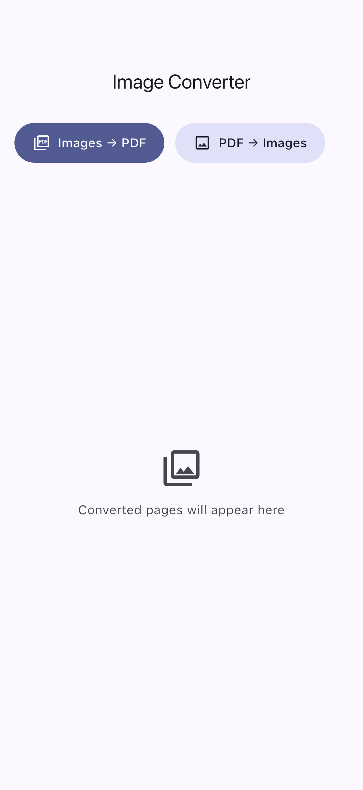
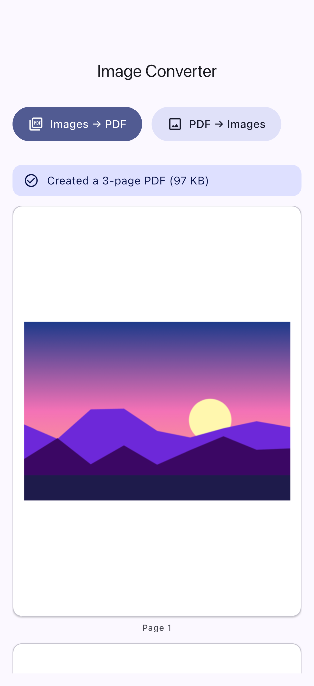
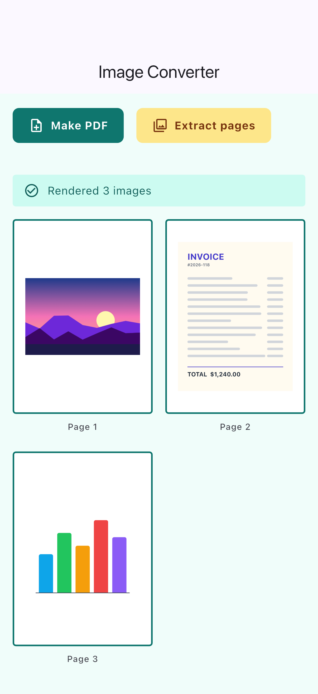
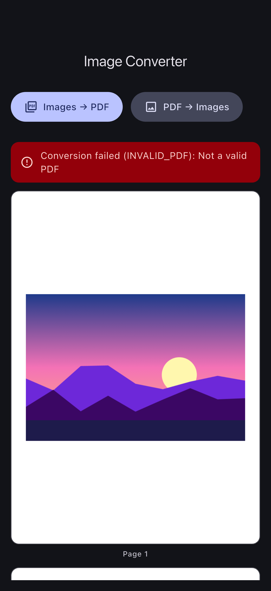

# image_converter

Convert **images → PDF** and **PDF → images** in Flutter with the PDF engine
built into Android and iOS. Use it **headless**, with just the conversion API
and no widgets, or **with UI**, using a ready-made converter screen whose
colours, text, shapes, icons and labels can all be themed.


<table>
  <tr>
    <td align="center"></td>
    <td align="center"></td>
    <td align="center"></td>
    <td align="center"></td>
  </tr>
  <tr>
    <td align="center"><sub>Default theme</sub></td>
    <td align="center"><sub>Images → A4 PDF</sub></td>
    <td align="center"><sub>Custom theme, grid</sub></td>
    <td align="center"><sub>Dark mode, error state</sub></td>
  </tr>
</table>

## Contents

- [Features](#features)
- [Installation](#installation)
- [With or without UI](#with-or-without-ui)
- [Converting in code](#converting-in-code)
- [Using it without UI](#using-it-without-ui)
- [Drop-in UI](#drop-in-ui)
- [Theming](#theming)
- [Errors](#errors)
- [Platform notes](#platform-notes)
- [Example app & tests](#example-app--tests)

## Features

- **Images → PDF.** One page per image. Pages can match each image's size or
  use a fixed size (A4, A5, Letter, Legal, or your own) with margins. Photos
  keep their correct orientation (EXIF is respected).
- **PDF → images.** Renders every page or a chosen set of pages to PNG or
  JPEG, at any DPI and JPEG quality.
- **Page count** for any PDF.
- **Bytes or files.** Every conversion takes and returns `Uint8List`, and
  helper methods work directly with file paths.
- **No third-party native libraries.** The plugin uses Android's
  `PdfDocument`/`PdfRenderer` and iOS's CoreGraphics/`UIGraphicsPDFRenderer`.
- **Off the UI thread.** Conversions run in the background on the native side.
- **Optional UI.** The core import has no widget or Material dependency and
  also works in background isolates. A separate import adds the widgets.
- **Customisable widgets.** A full converter screen plus the parts it is built
  from, styled by 37 theme variables with builder hooks for every section.

| Platform | Minimum | Image → PDF | PDF → image |
|----------|---------|-------------|-------------|
| Android  | API 21  | `android.graphics.pdf.PdfDocument` | `android.graphics.pdf.PdfRenderer` |
| iOS      | 13.0    | `UIGraphicsPDFRenderer` | `CGPDFDocument` |

## Installation

Add the package to your Flutter project:

```yaml
dependencies:
  image_converter: ^0.1.0
```

Requirements: Flutter 3.47 or later (Dart 3.13). On iOS the plugin supports
both Swift Package Manager and CocoaPods. On Android it uses built-in Kotlin
(AGP 9), like apps created with current Flutter.

No platform setup or permissions are needed. The plugin only works with bytes
and files you pass to it. To let users choose files, add a picker such as
[`file_picker`](https://pub.dev/packages/file_picker) or
[`image_picker`](https://pub.dev/packages/image_picker) and follow its own
setup steps.

## With or without UI

The package has two entry points. Import the one you need:

| Import | You get | Depends on |
|--------|---------|------------|
| `package:image_converter/image_converter.dart` | **Core.** `ImageConverter`, `ImageConverterController`, `PdfPageSize`, `ImageFormat`, file helpers | `flutter/foundation` and `flutter/services` only |
| `package:image_converter/image_converter_ui.dart` | **Core and UI.** Everything above plus `ImageConverterView`, the building-block widgets, `ImageConverterThemeData`, `ImageConverterTheme`, `ImageConverterLabels` | [`material_ui`](https://pub.dev/packages/material_ui) |

- **Headless.** Import only `image_converter.dart`. Use it with your own UI,
  with any state-management library, in a background isolate, or in code
  with no widgets at all.
- **With UI.** Import `image_converter_ui.dart`. It re-exports the core, so
  this one import covers everything.

You can mix the two: call the core API in one place and show
`ImageConverterView` in another. Both use the same native plugin.

A test (`test/library_split_test.dart`) checks that the core import never
pulls in Material (`material_ui` or `flutter/material`), Cupertino or the
widgets library.

The widgets are built on [`material_ui`](https://pub.dev/packages/material_ui),
which replaces the deprecated `package:flutter/material.dart`. If your app
still uses `flutter/material.dart`, follow
[`material_ui`'s migration guide](https://pub.dev/packages/material_ui), or
wrap the converter widgets in its `MaterialUiCompatibilityBridge`.

## Converting in code

```dart
import 'package:image_converter/image_converter.dart';

const converter = ImageConverter();

// Images -> PDF
final Uint8List pdf = await converter.imagesToPdf(
  [photoBytes, scanBytes],
  pageSize: PdfPageSize.a4,   // null (default): each page matches its image
  margin: 24,                 // points; the image is fitted and centred
);

// PDF -> images
final List<Uint8List> pages = await converter.pdfToImages(
  pdf,
  dpi: 150,                   // 72 = 1 pixel per point
  format: ImageFormat.jpeg,   // or ImageFormat.png (default)
  quality: 85,                // JPEG only, 0-100
  pages: [0, 2],              // optional, zero-based
);

final int count = await converter.pdfPageCount(pdf);
```

### Working with files

```dart
await converter.imageFilesToPdfFile(
  ['/path/a.jpg', '/path/b.png'],
  '/path/out.pdf',
  pageSize: PdfPageSize.letter.landscape,
);

// Writes page_1.png, page_2.png, ... into the folder (created if needed).
final files = await converter.pdfFileToImageFiles('/path/in.pdf', '/path/pages');
```

### Page sizes

Sizes are in PostScript points (1/72 inch). Use a preset (`PdfPageSize.a4`,
`a5`, `letter`, `legal`), call `.landscape` on any size, or define your own
with `PdfPageSize(width, height)`.

## Using it without UI

Everything below needs only the core import:

```dart
import 'package:image_converter/image_converter.dart';
```

### Plain calls

Use the `ImageConverter` API shown above directly. If you call it before
`runApp`, for example during start-up, initialise the binding first, as you
would for any plugin:

```dart
Future<void> main() async {
  WidgetsFlutterBinding.ensureInitialized();
  final pdf = await const ImageConverter().imagesToPdf(images);
  // ...
}
```

### Background isolate

Conversions already run off the UI thread on the native side. If you also
want the Dart-side work (reading files, post-processing) off the main
isolate, the plugin works from a background isolate:

```dart
import 'dart:isolate';
import 'package:flutter/services.dart';
import 'package:image_converter/image_converter.dart';

final token = RootIsolateToken.instance!;
final pdf = await Isolate.run(() async {
  BackgroundIsolateBinaryMessenger.ensureInitialized(token);
  return const ImageConverter().imagesToPdf(images, pageSize: PdfPageSize.a4);
});
```

### Controller with your own UI or state management

`ImageConverterController` is a plain `ChangeNotifier` with no widget
dependency. It tracks `state` (`idle` / `converting` / `success` / `error`),
`kind`, `pdf`, `pages` and `error`. Plug it into `ListenableBuilder`,
Provider, Riverpod, Bloc, or a simple listener:

```dart
final controller = ImageConverterController();
controller.addListener(() {
  switch (controller.state) {
    case ConversionState.converting: showSpinner();
    case ConversionState.success:    upload(controller.pdf!);
    case ConversionState.error:      report(controller.error!);
    case ConversionState.idle:       break;
  }
});

await controller.imagesToPdf(images, pageSize: PdfPageSize.a4, previewDpi: null);
// previewDpi: null skips rendering preview images when you don't display them.
```

The controller returns `null` on failure instead of throwing and keeps the
error in `controller.error`. Call `ImageConverter` directly if you'd rather
handle exceptions yourself.

## Drop-in UI

The widgets come from the UI import:

```dart
import 'package:image_converter/image_converter_ui.dart';
```


`ImageConverterView` is a complete converter screen with action buttons, a
progress bar, a status banner and a gallery of the resulting pages. You supply
the file picking:

```dart
Scaffold(
  appBar: AppBar(title: const Text('Converter')),
  body: ImageConverterView(
    onPickImages: () async {
      final r = await FilePicker.pickFiles(
          type: FileType.image, allowMultiple: true, withData: true);
      return r?.files.map((f) => f.bytes).whereType<Uint8List>().toList();
    },
    onPickPdf: () async {
      final r = await FilePicker.pickFiles(
          type: FileType.custom, allowedExtensions: ['pdf'], withData: true);
      return r?.files.single.bytes;
    },
    pageSize: PdfPageSize.a4,
    margin: 24,
    galleryLayout: PdfGalleryLayout.grid,
    onPdfCreated: (pdf) => savePdf(pdf),
    onImagesCreated: (images) => saveImages(images),
    onError: (error) => log('$error'),
  ),
)
```

A button only appears when its pick callback is set. The view needs a bounded
height, such as a `Scaffold` body, because the gallery fills the remaining
space.

### Building blocks

The view is built from these public pieces, which you can also use on their
own:

| Widget / class | What it is |
|----------------|-----------|
| `ConverterButton` | Action button with a built-in loading spinner, in `primary` or `secondary` style |
| `ConversionProgressBar` | Linear progress bar; indeterminate by default, or pass `value` |
| `ConversionStatusBanner` | `info` / `success` / `error` message with an icon and an optional `trailing` widget |
| `PdfPagePreview` | One page in a card with a caption and an optional `onTap` |
| `PdfPageGallery` | List or grid of pages, with an empty state |
| `ImageConverterController` | A `ChangeNotifier` that runs conversions and exposes `state`, `kind`, `pdf`, `pages` and `error` |

### Replacing sections

Every section of `ImageConverterView` can be replaced. The section builders
receive the controller, so custom UI can start conversions too:

```dart
final controller = ImageConverterController();

ImageConverterView(
  controller: controller,                       // optional: read results / drive it yourself
  header: const Text('Scan to PDF'),
  actionsBuilder: (context, c) => ElevatedButton(
    onPressed: c.isConverting ? null : () async {
      final images = await pickImages();
      if (images != null) await c.imagesToPdf(images, pageSize: PdfPageSize.a4);
    },
    child: const Text('Scan'),
  ),
  progressBuilder: (context, c) => const LinearProgressIndicator(),
  statusBuilder: (context, c) => Text('State: ${c.state.name}'),
  pageItemBuilder: (context, index, bytes) => Image.memory(bytes),
  emptyBuilder: (context) => const Text('Nothing yet'),
  // or replace the whole gallery:
  // galleryBuilder: (context, c) => MyGallery(c.pages),
)
```

## Theming

`ImageConverterThemeData` holds every visual setting. Every field is optional.
Any field you leave null takes a default from your app's `ColorScheme` and
`TextTheme`, so the widgets match your app and dark mode works without extra
setup.

### Three ways to apply a theme

When more than one of these sets the same field, the earlier one in this list
wins:

1. **A widget's own argument**, e.g. `ConverterButton(backgroundColor: …)`, or
   `ImageConverterView(theme: …)` for a single view.
2. **`ImageConverterTheme`** around part of the widget tree. Nested ones
   combine field by field.
3. **A `ThemeData` extension** for the whole app.

```dart
MaterialApp(
  theme: ThemeData(
    colorSchemeSeed: Colors.indigo,
    extensions: const [
      ImageConverterThemeData(
        primaryColor: Color(0xFF0F766E),
        onPrimaryColor: Colors.white,
        secondaryColor: Color(0xFFFDE68A),
        onSecondaryColor: Color(0xFF78350F),
        backgroundColor: Color(0xFFF0FDFA),
        borderColor: Color(0xFF0F766E),
        borderWidth: 2,
        buttonBorderRadius: BorderRadius.all(Radius.circular(8)),
        buttonTextStyle: TextStyle(fontWeight: FontWeight.w700),
        spacing: 16,
        imagesToPdfIcon: Icons.note_add_outlined,
        labels: ImageConverterLabels(
          imagesToPdf: 'Make PDF',
          pdfToImages: 'Extract pages',
        ),
      ),
    ],
  ),
);

// Override one part of the screen only:
ImageConverterTheme(
  data: const ImageConverterThemeData(progressColor: Colors.amber),
  child: const ConversionProgressBar(),
);
```

This is the theme behind the **Custom theme, grid** screenshot above.

### Theme variables

| Group | Variable | Default |
|-------|----------|---------|
| **Colours** | `primaryColor` / `onPrimaryColor` | `colorScheme.primary` / `onPrimary` |
| | `secondaryColor` / `onSecondaryColor` | `secondaryContainer` / `onSecondaryContainer` |
| | `backgroundColor` | `surface` |
| | `surfaceColor` / `onSurfaceColor` | `surfaceContainerHigh` / `onSurface` |
| | `mutedColor` | `onSurfaceVariant` |
| | `borderColor` | `outlineVariant` |
| | `errorColor` / `errorContainerColor` | `onErrorContainer` / `errorContainer` |
| | `successColor` / `successContainerColor` | `onPrimaryContainer` / `primaryContainer` |
| | `progressColor` / `progressTrackColor` | `primary` / `primaryContainer` |
| | `pageBackgroundColor` | `Colors.white` |
| **Text** | `buttonTextStyle` | `textTheme.labelLarge` |
| | `statusTextStyle` | `textTheme.bodyMedium` |
| | `pageLabelTextStyle` | `textTheme.labelSmall` |
| | `emptyTextStyle` | `textTheme.bodyMedium` |
| **Shape & spacing** | `borderRadius` | 12 |
| | `buttonBorderRadius` | 24 |
| | `buttonPadding` | 20 × 12 |
| | `buttonMinHeight` | 44 |
| | `contentPadding` | 16 |
| | `spacing` | 12 |
| | `borderWidth` (0 hides the border) | 1 |
| | `pageElevation` | 1 |
| | `pagePadding` | 0 |
| | `progressHeight` | 4 |
| | `iconSize` | 20 |
| **Icons** | `imagesToPdfIcon`, `pdfToImagesIcon`, `successIcon`, `errorIcon`, `emptyIcon` | Material outlined icons |
| **Text content** | `labels` | `ImageConverterLabels()` |

`ImageConverterThemeData` supports `copyWith`, `merge` and `lerp`, so it
animates when the app theme changes. `ImageConverterTheme.of(context)` returns
the fully resolved values for your own widgets.

### Labels and localisation

`ImageConverterLabels` holds every string the widgets show. The dynamic
messages are functions, so they can handle plurals and translations:

```dart
ImageConverterLabels(
  imagesToPdf: 'Bilder → PDF',
  pdfToImages: 'PDF → Bilder',
  converting: 'Konvertiere…',
  empty: 'Noch keine Seiten',
  page: (n) => 'Seite $n',
  pdfCreated: (pages, bytes) => 'PDF mit $pages Seiten erstellt',
  imagesCreated: (n) => '$n Bilder erstellt',
  error: (e) => 'Fehler: $e',
)
```

## Errors

Invalid arguments throw `ArgumentError` / `RangeError` in Dart before
anything reaches the platform. Native failures throw `PlatformException` with
one of these codes:

| Code | When |
|------|------|
| `INVALID_ARGUMENT` | Missing input, or the requested render is too large (over about 100 MP per page) |
| `INVALID_IMAGE` | An image couldn't be decoded. The message includes its index |
| `INVALID_PDF` | The bytes aren't a readable PDF |
| `PDF_ENCRYPTED` | The PDF is password protected |
| `INVALID_PAGE` | A requested page index is out of range |
| `CONVERSION_FAILED` | Any other native failure, including running out of memory |

`ImageConverterView` catches these, shows them in the error banner, and
passes them to `onError`.

## Platform notes

- **Input formats:** any format the platform can decode. That always includes
  PNG and JPEG, and HEIC/WebP on OS versions that support them.
- **Page sizing:** with `pageSize: null`, 1 image pixel becomes 1 point, so
  large photos produce large pages. Pass a page size to get printable output.
- **Transparency:** transparent areas of PDF pages are rendered on white.
- **Password-protected PDFs** aren't supported. On iOS, PDFs whose user
  password is empty still open.
- **Memory:** each conversion holds the images and the PDF in memory. For very
  large documents, render pages in batches using `pages:`.

## Example app & tests

`example/` contains a demo app built on `ImageConverterView`. It picks files
with `file_picker`, and a switch in the app bar toggles the custom theme.

```sh
cd example
flutter run
```

Tests:

```sh
flutter test                                      # Dart unit and widget tests
cd example
flutter test                                      # example widget test
flutter test integration_test/plugin_integration_test.dart -d <device>   # real native conversions
flutter test integration_test/headless_test.dart -d <device>             # core only: no widgets, background isolate, controller
```

Native unit tests run from `example/android` with
`./gradlew :image_converter:testDebugUnitTest`, and on iOS through the
`RunnerTests` target in Xcode.

### Regenerating the screenshots

The screenshots above come from `example/integration_test/screenshots_test.dart`,
which runs real conversions on generated sample images:

```sh
cd example
flutter drive --driver=test_driver/integration_test.dart \
  --target=integration_test/screenshots_test.dart -d <ios-simulator-id>
```

The images are written to `doc/screenshots/`.

## License

MIT. See [LICENSE](LICENSE).
